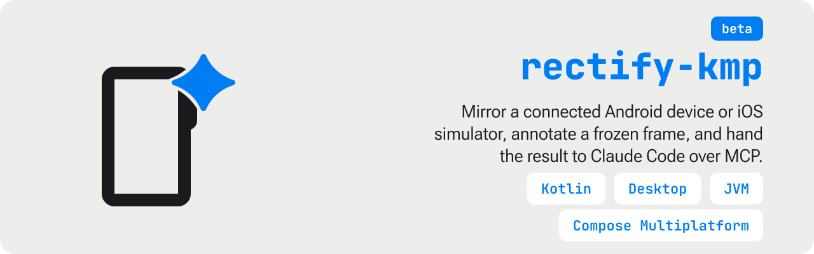
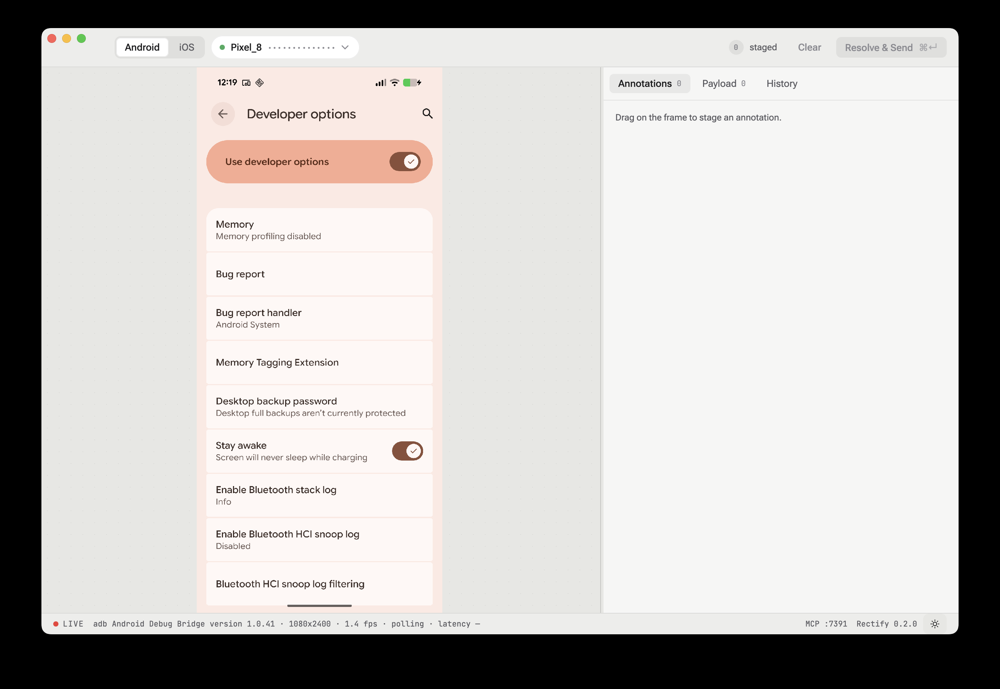

<p align="center">
  
</p>

# Rectify

**Mirror a device, box the bug, hand it to Claude Code — then prove it was fixed.**

Spotting a visual bug on a real device is easy. Describing it precisely is not. The usual path
is a screenshot, a sentence of prose about roughly where the problem is, and the loss of
everything that made the observation useful — the exact region, the pixel or dp gap, the view
that owns it. And once the agent claims a fix, there is no way to check it other than re-opening
the app and eyeballing the same spot from memory.

Rectify keeps that context attached to the report, and keeps the original frame around so the
check is a diff rather than a recollection.



## The loop

Every other tool in this space does one leg of it. Rectify's claim is the round trip.

| | |
|---|---|
| **Mirror** | A live frame from an Android handset or emulator over `adb`, or an iOS simulator over `xcrun simctl` and `idb`. |
| **Annotate** | Drag on the frame. The exact pixels freeze, and the box becomes a numbered annotation with a comment field. |
| **Measure** | Hold <kbd>⌥</kbd> and the box snaps to the matched hierarchy node, reporting dp gaps to its neighbours. |
| **Send** | One action packages frame, crops, hierarchy XML and a generated prompt, and publishes them for the local MCP server to serve. |
| **Verify** | Re-capture the device and diff each annotated region against the frozen original. Matches resolve; mismatches offer a one-click re-send. |

## Quick start

Grab `Rectify-*.dmg` from the
[latest release](https://github.com/andrew-malitchuk/rectify-kmp/releases/latest) — Apple
Silicon, unsigned, so right-click → **Open** on first launch. To build it yourself instead:

Requires **macOS** and **JDK 21+**. `adb` on your `PATH` for Android devices, Xcode command line
tools for iOS simulators — Rectify launches without either and reports what is missing as a
recoverable error card.

```shell
git clone https://github.com/andrew-malitchuk/rectify-kmp.git
cd rectify-kmp
./gradlew :desktop-application:run
```

Then point Claude Code at the MCP endpoint the app serves on loopback. Click `MCP :7391` in
Rectify's status bar — a card shows the exact line with a Copy button (the port moves if 7391
was taken):

```shell
claude mcp add --transport http rectify http://127.0.0.1:7391/mcp
```

Full walkthrough: [Installation](docs/content/guide/installation.md).

## Documentation

The guide and the architecture notes are built from `docs/` and published to GitHub Pages:

```shell
./gradlew generateDocs
python3 -m http.server -d docs-generator/build/docs-site 8000
```

See [`docs/README.md`](docs/README.md) for how the site is authored and deployed.

## What it is not

- **Not a cloud service.** Everything runs locally under `~/.rectify/`. No account, no sync, no auth.
- **Not a remote-control tool.** The mirror is read-only; Rectify never injects taps or keys.
- **Not a multiplatform app.** Rectify runs on the desktop only.

That last point is worth repeating while reading the source: **"Android" and "iOS" are domain
concepts here, not build targets.** Every module is a plain `kotlin("jvm")` module with the
classic `src/main` / `src/test` layout — `AdbHostSource`, `SimctlDevicesParser` and friends are
the product, not a platform source set.

## Architecture

<details>
<summary>Module map</summary>

```
rectify-kmp/
├── build-logic/convention/          ← Gradle convention plugins
├── compose-application/             ← App composition + the Rectify window
├── desktop-application/             ← Plain-JVM module hosting main()
├── docs-generator/                  ← Renders docs/ into the GitHub Pages site
│
├── presentation-feature-mirror/     ← Device discovery, mirroring, annotate & send
├── presentation-core-ui/            ← Shared UI component library (atoms → organisms)
├── presentation-core-styling/       ← Theme tokens, colours, typography
├── presentation-core-localisation/  ← String resources
│
├── domain-core/                     ← Shared domain models
├── domain-repository-api/           ← Repository interfaces
├── domain-usecase-api/              ← Use case interfaces
├── domain-usecase-impl/             ← Use case implementations (theme, language, device, history)
│
├── data-core/                       ← Shared data-layer utilities
├── data-device-api/                 ← Device discovery / mirroring contracts and parsers
├── data-device-impl/                ← adb / emulator / xcrun / idb process drivers
├── data-handoff-api/                ← Handoff contract: the UI writes it, the MCP endpoint reads it
├── data-mcp-impl/                   ← The MCP endpoint the app serves on 127.0.0.1
├── data-preference-api/             ← Preference source interfaces
├── data-preference-impl/            ← Preference implementations (java.util.prefs)
├── data-database-api/               ← Local database contracts
├── data-database-impl/              ← Room database implementation (sent-batch history)
├── data-repository-impl/            ← Repository implementations
└── common-core/                     ← Shared utilities
```

Four convention plugins under `dev.rectify.io.convention` configure them — `application`,
`feature`, `library` and `di`. Explicit API mode is on everywhere.

</details>

### Tech stack

| Aspect | Library |
|---|---|
| UI | Compose Multiplatform 1.12.1, Material3 |
| State management | Orbit MVI 12.0.1 |
| Dependency injection | Koin 4.2.2 |
| Local database | Room 2.8.5 |
| Preferences | multiplatform-settings 1.3.0 |
| Serialization | kotlinx-serialization 1.11.0 |
| Coroutines | kotlinx-coroutines 1.11.0 |
| Build | Gradle 9.8.1, Kotlin 2.4.21, JVM 21 |

### Building

```shell
./gradlew build    # compile everything and run every suite
./gradlew check    # all checks
```

## License

Apache 2.0 — see [LICENSE](LICENSE). Copyright (c) 2026 Andrew Malitchuk.
