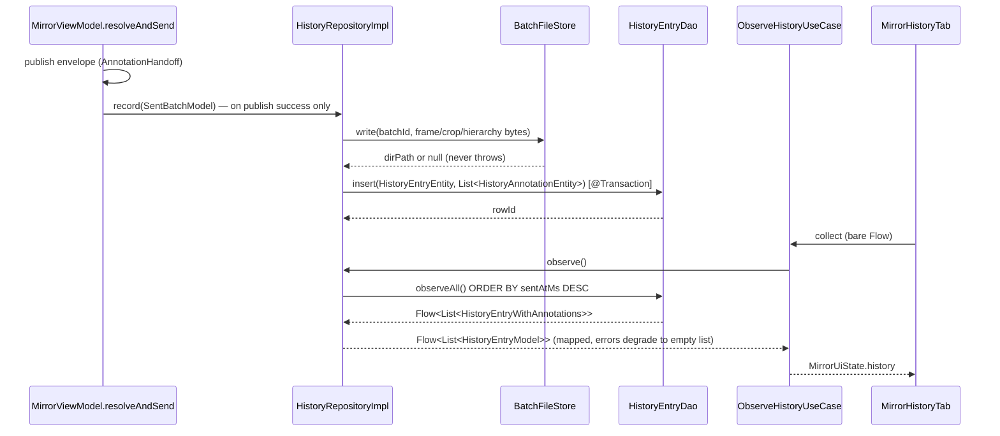

# data-database-impl — Claude Instructions

## Module Purpose

Room database implementation. Provides the local persistence layer — KSP-generated Room DAOs
for Desktop — backing Rectify's sent-batch history: two normalised tables
(`history_entry`, `history_annotation`), a transactional insert, an ordered observe query, and
a targeted status update, exposed through the public `HistoryDataSource`.

## Package Layout Convention

```
data.database.impl/
├── core/                                — internal only (package-layout.md)
│   ├── DatabaseBuilder.kt                — internal expect function (platform-specific DB init)
│   ├── database/
│   │   └── AppDatabase.kt                — @Database(version = 1), AppDatabaseConstructor
│   ├── dao/
│   │   └── HistoryEntryDao.kt            — internal @Dao: insert (transaction), observeAll,
│   │                                        findById (transaction, single row by primary key,
│   │                                        F-9's read path), updateStatus
│   ├── datasource/
│   │   └── HistoryDataSourceImpl.kt      — internal HistoryDataSource, unpacks the DAO's relation
│   └── migration/
├── source/                               — public API surface (package-layout.md)
│   ├── entity/
│   │   ├── HistoryEntryEntity.kt         — public @Entity: public because it is the wire type
│   │   │                                    of the public HistoryDataSource (see
│   │   │                                    .claude/rules/database.md's source/entity/ exception)
│   │   ├── HistoryAnnotationEntity.kt    — public @Entity, FK CASCADE on HistoryEntryEntity.id
│   │   └── HistoryEntryWithAnnotations.kt — public @Embedded/@Relation read shape
│   └── datasource/
│       └── HistoryDataSource.kt          — public: ObservableDataSource + AppendableDataSource,
│                                            plus bespoke getBatch(id) and updateStatus(id, status)
└── di/
    └── DataDatabaseImplModule.kt
```

`core/DatabaseBuilder.kt` stores the database at **`~/.rectify/rectify.db`** (relocated from
the former `~/rectify.db` in the same change that added the history tables — see the version-1
note below), creating `~/.rectify/` on demand. Also sets
`.setQueryCoroutineContext(Dispatchers.IO)`.

## Architecture

Dependency chain: `DataDatabaseImplModule` → `DatabaseBuilder` → `AppDatabase`
→ `HistoryEntryDao` → `HistoryDataSourceImpl` (bound to the public `HistoryDataSource`).
Entity ↔ domain-model mapping (`HistoryEntryMapper`) lives in `data-repository-impl`, not here —
this module only ever produces/consumes its own `@Entity` types.

### Record-and-observe path

The one diagram this module needs — where a sent batch's row comes from and how it reaches the
History tab. Placed here rather than in `presentation-feature-mirror` or `data-repository-impl`
because this module is the single downstream point every write and every read passes through;
the entity/DAO shape below is what the rest of the path exists to feed.



## No `@ConstructedBy` / `RoomDatabaseConstructor`

That pair is the Room *KMP* pattern, needed only when an `expect object` constructor has to be
generated per target. This is a plain JVM project: Room resolves `AppDatabase_Impl` itself, and
`AppDatabase` carries `@Database` alone. Don't reintroduce `AppDatabaseConstructor` — it does
not compile without the Kotlin Multiplatform plugin.

## Room Database

Current schema version: **1**, with two tables: `history_entry` (one row per sent batch) and
`history_annotation` (its per-rect children, `FOREIGN KEY ... ON DELETE CASCADE`, indexed on
`batchId`). `exportSchema = true` — `schemas/` holds the exported JSON for version 1.

This shipped at version 1 with **no `Migration`**, which is an exception, not the default rule
(see `.claude/rules/database.md`): the same change relocated the desktop DB file to
`~/.rectify/rectify.db`, a path nothing had ever written to, which is what made skipping the
migration provably safe. The next schema change that touches `history_entry` or
`history_annotation` on the *current* path needs a real `Migration` — create
`core/migration/Migrations.kt` for it (the former empty placeholder was deleted as dead code).

**F-9 (verify-and-rediff-loop) stayed at version 1 too, with no new column.** It reads
`history_entry`/`history_annotation` through `findById` only — the per-annotation `densityDpi`
a verify run needs comes from the fresh AFTER hierarchy dump, not a stored column, because a
`Migration` could never retroactively supply density for rows already on disk. Confirmed against
`HistoryEntryEntity`/`HistoryAnnotationEntity` during F-9's planning: no column was added, so the
version-bump-plus-`Migration` rule above was never triggered.

## KSP Configuration

Room code generation is wired with the ordinary `ksp(libs.room.compiler)` configuration — no
per-target `ksp<Target>` entries. See `build.gradle.kts`.

## Testing

`src/test` has a `kotlinx-coroutines-test` dependency (added for the Room round-trip spike
that preceded the first real tables). `HistoryEntryDaoTest` (7 cases) exercises
the real KSP-generated code and `BundledSQLiteDriver` against an in-memory/temp database:
transactional parent+children insert, cascade delete, `observeAll()` ordering, and the
targeted `updateStatus()` no-op-on-unknown-id case.

## Adding Another Table

1. Add the `@Entity` class(es) — under `source/entity/` if (and only if) a public datasource
   returns it, otherwise `core/entity/`.
2. Add DAO method(s) to `HistoryEntryDao.kt` or a new internal `@Dao` under `core/dao/`.
3. Update `AppDatabase.entities` and add the DAO accessor method.
4. Bump `@Database(version = ...)` and add a `Migration` in `core/migration/Migrations.kt` — the version-1,
   no-migration shortcut above does not generalise; it relied on a provably unwritten file.

## Build

```shell
./gradlew :data-database-impl:build
```

Schema JSON files are exported to `schemas/` — commit these to track migrations in version
control.
