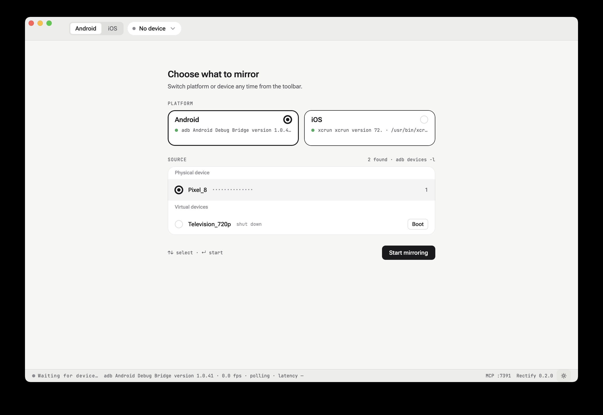

# Connecting a device

Rectify polls for devices every two seconds and shows whatever it finds. There is no connect
step to remember — plug something in and it appears.

## The platform switch

The toolbar's leftmost control chooses which world you are looking at: **Android** or **iOS**.
Each platform has its own discovery loop, its own tool, and its own device list.

Switching platforms is a clean break. The previous platform's poll is cancelled, its device
list is cleared, and any device you had selected is forgotten — a Pixel is not a thing the iOS
tab can mirror, so leaving it named in the toolbar would be a lie.

| Platform | Tool | What it finds |
|---|---|---|
| Android | `adb devices -l` | Physical handsets and running emulators |
| Android | `emulator -list-avds` | Shut-down AVDs, offered with an inline **Boot** button |
| iOS | `xcrun simctl list devices available` | Simulators, booted or not |
| iOS | `idb list-targets` | Physical devices, if `idb` is installed |

## The picker

With a platform selected and something attached, the stage shows **Choose what to mirror**:

- **Physical device** — handsets and iPhones.
- **Virtual devices** — emulators and simulators. A shut-down one is still listed, with a
  **Boot** button beside it, so you do not have to leave Rectify to start it.

Navigate with <kbd>↑</kbd> <kbd>↓</kbd> and commit with <kbd>↵</kbd>, or click. The **Start
mirroring** button does the same thing as <kbd>↵</kbd>.

<kbd>Esc</kbd> closes the picker — but only once you have something to go back to. Before your
first selection there is nothing behind it, so <kbd>Esc</kbd> deliberately does nothing rather
than stranding you on an empty stage.

Once a device is selected, the toolbar chip shows its name and serial. Click the chip to reopen
the picker at any time.

## Nothing attached

If the tool is present but sees no device, the stage explains what to do rather than showing an
empty box: plug in a phone with USB debugging on and accept the prompt, or boot an emulator from
the inline selector. The footer reports what is being polled and how often.

The copy follows the selected platform. On iOS there is no USB debugging prompt and no AVD, so
it talks about simulators and `xcrun simctl` instead.

## The mirror

Once the stream starts the stage shows the live frame, and the status bar reports what is
actually happening:

```
● LIVE   adb Android Debug Bridge version 1.0.41 · 1080x2400 · 0.3 fps · polling · latency —
```

The frame rate is low on purpose. Rectify captures still frames for annotation, not video for
playback — the loop is `screencap`-based, and a higher rate would cost device CPU for a stream
nobody watches in motion.

Between pressing **Start mirroring** and the first decoded frame you get a spinner. On a cold
`adb` start the gap is long enough that an empty stage would read as a hang.

## If the stream drops

A device that disappears mid-session does not throw away your work. A banner appears over the
now-stale frame explaining what happened, your staged annotations stay pinned to the frozen
frame, and **Resolve & Send** keeps working — the batch is already captured, and sending it does
not need the device back.



**Reconnect** in the banner restarts the stream.
