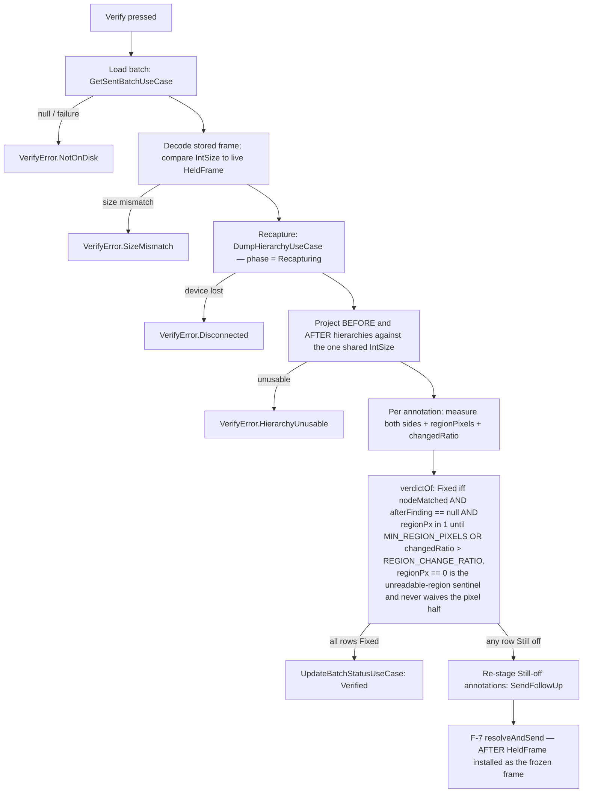

# presentation-feature-mirror

The Android device-discovery and mirroring surface: tool detection, the device picker, the
waiting stage, the live frame, and the Verify / re-diff loop (F-9) that re-captures a sent
batch's device and reports a per-annotation Fixed / Still off verdict. Orbit MVI, as
`.claude/rules/orbit-mvi.md` prescribes — with two documented deviations.

## Deviation 1: `MirrorHost`, not `MirrorScreen`

There is **no `Destination` for this surface**, and there will not be one. It is not a page the
navigation graph can reach: it is the set of slots the desktop window
(`compose-application/.../RectifyWindow.kt`) fills — toolbar switch, device chip, status line,
stage. The entry point is therefore `MirrorHost`, which owns no layout and hands
`(state, frame, hierarchy, verifyFrames, onIntent)` to a content lambda — see "`MirrorHost`'s
signature" below for the full five-argument shape.

`.claude/rules/navigation.md`'s five-step checklist is deliberately **not** applied: no
`Destination` case, no `navSavedStateConfiguration` entry, no `NavigationHost` branch. This
paragraph exists so a reviewer does not flag the omission as an oversight.

## Deviation 2: pixels never enter the reduced state

`MirrorUiState` carries no frame bytes. Decoded frames are published on
`MirrorViewModel.frame`, a `StateFlow<ImageBitmap?>` **outside** Orbit:

- a `ByteArray`-bearing type compares by identity, so a frame in reduced state could never
  deduplicate, and
- at up to ten frames a second it would mean ten reducer passes and ten full state copies a
  second, inherited by every future feature that reads this state.

Transport statistics are reduced at most once a second (a conflated collector that sleeps
between reductions), not once per frame. Pixels are a stream; UI semantics are a state machine.

The verify loop's BEFORE/AFTER bitmap pair follows the identical rule: `VerifyFrames` (the pair)
travels on `MirrorViewModel.verifyFrames`, a `StateFlow<VerifyFrames?>`, and reaches the UI as a
**fifth** argument handed down through `MirrorHost`'s `content` lambda — see "`MirrorHost`'s
signature" below. `MirrorUiState.rows: List<VerificationRow>` carries only the verdicts and
labels (no pixels), same shape as every other reduced row type in this contract.

## Deviation 3: the verify arithmetic has exactly one `ImageBitmap`-aware file

`core/verify/` is pure `IntArray` arithmetic end to end, with one deliberate exception:
`RegionPixels.kt`'s `ImageBitmap.regionPixels()` extension is **the only function in the verify
path that names `ImageBitmap`**, and only as its extension receiver. Every other verify function
(`changedRatio` in `RegionDiff.kt`, `verdictOf` in `VerifyVerdict.kt`, `beforeAfterLabel` in
`BeforeAfterFormat.kt`) takes `IntArray`s and primitives, which is what keeps the pixel-diff
arithmetic unit-testable with no graphics backend (this module's `desktopTest` has no Skiko —
see `MirrorFakes.kt`'s own note on why `ImageBitmap(w, h)` cannot be constructed there). Reusing
`ImageBitmap.readPixels` directly, rather than inventing a `PixelDiffer` seam, was a deliberate
choice: a seam here would be an interface with one real implementation, and it would push the
arithmetic into `desktopMain` — which still has no Skiko, so it would destroy testability for
nothing. `regionPixels()` is correspondingly the one verify function left **deliberately
untested**: there is no arithmetic in it for a test to check beyond what Compose's own
`readPixels` already guarantees.

A hygiene grep for this rule: `grep -rn ImageBitmap core/verify/` must return only
`RegionPixels.kt` for an import/type use, plus an incidental KDoc mention in `RegionDiff.kt`
(prose explaining *why* the readback lives elsewhere) — never a second import or a second
function signature.

## Layout

- `source/mirror/` — `MirrorContract`, `MirrorViewModel`, `MirrorHost`, `MirrorContent`,
  `MirrorVerifyStage` (the Verify stage's two-column BEFORE/AFTER layout, F-9).
  `MirrorContent` exposes `MirrorStageContent` (one branch per `MirrorStage` case — `Picker`,
  `Mirror`, `NoSignal`, `Frozen`, `Verify`) and `MirrorStatusLine` (the status
  bar's leading slot); both are stateless and read `stringResource` for every piece of copy,
  which is why the semantic row/stage types in the contract carry no labels.
- `core/verify/` — the verify loop's pure core: `RegionDiff.changedRatio` (Chebyshev RGB over
  `IntArray`), `VerifyThresholds` (`CHANNEL_NOISE_FLOOR`, `REGION_CHANGE_RATIO`,
  `MIN_REGION_PIXELS` — tuning knobs, never asserted by literal value in a test, see
  `VerifyThresholds.kt`'s own KDoc for the tuning method), `VerifyVerdict.verdictOf` (the
  Fixed/Still-off AND-rule), `BeforeAfterFormat`, `RegionPixels` (the one `ImageBitmap`-aware
  file, see Deviation 3), `VerifyLabels`, `FollowUp`.
- `core/measure/` — `FindingKind` is now declared on the public contract (`MirrorContract.kt`),
  not `core/measure/`, because `MeasureReadout.findingKind` needs it on a public type;
  `SEPARATOR` is `internal` (widened from `private` for the verify loop's label formatting).
- `core/picker/` — `nextSelectableIndex` / `firstSelectableIndex`.
- `core/discovery/` — `applyDiscovery`, the pure discovery-to-state projection. It is separate
  because of one subtlety worth a direct test: `DiscoveryModel.NoDeviceFound` carries **no**
  emulator list, so the last known AVDs have to be retained across an escalation or the Boot
  shortcut goes empty exactly when the user needs it.
- `core/stats/` — `formatStatusLine`.

## `MirrorHost`'s signature

`MirrorHost`'s `content` lambda takes **five** arguments:
`(MirrorUiState, ImageBitmap?, HierarchySnapshotModel, VerifyFrames?, (MirrorIntent) -> Unit) -> Unit`.
The fourth argument (`VerifyFrames?`, the BEFORE/AFTER bitmap pair) was added for the verify loop
(F-9) as a genuinely new argument rather than folded into a holder type with the frame — the
frame, the frozen hierarchy and the verify pair have three different lifetimes and this is the
one call site that has to track all three. There is exactly **one** `MirrorHost` call site
(`compose-application`'s `RectifyWindow.kt`); keep it that way.

## Verify loop (F-9)

One click on a sent History batch re-captures the live device, diffs it per annotation against
the batch's frozen frame, and renders a per-annotation Fixed / Still off verdict:

Every abort path (`E1`-`E4`, plus a mid-run device change) produces a named `VerifyError` and an
**empty** rows list — an abort can never be mistaken for a verdict. A run the user ABANDONED
produces nothing at all, not even an error: `verifyJob.cancel()` cannot stop a run (Orbit's
`reduce` is a `suspend fun` with no suspension point, and `adb`'s dump is an uninterruptible
process read), so a run carries a `verifyRunId` captured at its start and returns silently at
the first check after a cancel. `MirrorFakes`' use-case gates swallow cancellation on purpose
so the suite tests that guard rather than the fakes' good manners. A zero-row run (no
annotations at all) writes no status. `MarkAllVerified` does not exit the Verify stage; `ExitVerify`
does, and both routes release the same five verify-scoped fields through one `releaseVerify()`.
The follow-up send carries the run's AFTER hierarchy forward (CR-B) but not the BEFORE one — no
caller has needed it.

Placed here, not in `data-database-impl` or `data-repository-impl`, because `MirrorViewModel`
is the one place every step of the loop — load, recapture, project, diff, verdict, re-stage —
actually runs; the other modules only ever see one step each (the read, the send).

## Testing

`commonTest` compiles for **every** target: a backtick test name containing a comma, an
apostrophe or a colon passes on the JVM and fails `compileTestKotlinIosArm64` with
`Name contains illegal characters`. Plain-word camelCase names only.

Two environment facts the ViewModel tests depend on, both in `MirrorFakes.kt`:

- Orbit runs its container event loop on `Dispatchers.Default`, so a test has to pin it with
  `Orbit.configureDefaults { eventLoopDispatcher = { testDispatcher } }` (the library's own
  hook) or nothing the reducer does is visible to `advanceUntilIdle()`. No `orbit-test`
  dependency is used — it is not in the catalog.
- Since coroutines 1.11, `advanceUntilIdle()` ignores `backgroundScope` work, so the state
  subscription that triggers Orbit's lazy `onCreate` must be started with `runCurrent()`.
